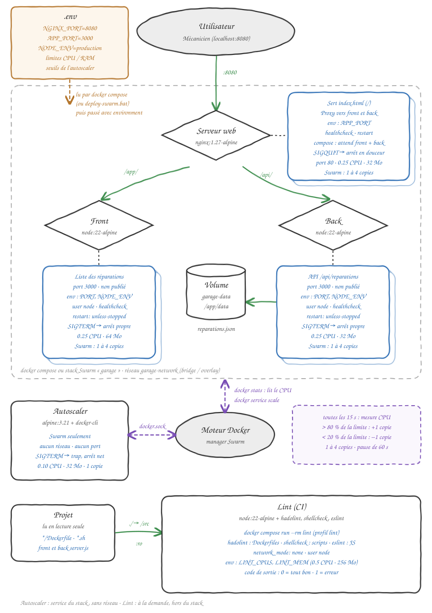

# Projet Docker : To-Do List d'un garage moto

Le sujet de mon projet est une **To-Do List pour un garage moto** : les mécaniciens voient la liste
des réparations à faire sur chaque moto (modèle, immatriculation, travail à faire) et ce qui est
déjà fait.

Il y a 3 conteneurs :

- **front** : la page avec la liste des réparations
- **back** : l'API qui renvoie les réparations (stockées dans un fichier JSON)
- **serveur-web** : Nginx, le seul point d'entrée, qui redirige vers le front et le back

Et 2 conteneurs d'outillage (orchestration et CI), comme demandé dans la consigne supplémentaire :

- **autoscaler** : ajoute ou enlève des copies du front, de l'API et de Nginx selon le CPU (avec Swarm)
- **lint** : vérifie les Dockerfiles, le script de l'autoscaler et le code Node.js (voir [Le lint](#le-lint-ci))

## Technologies utilisées

- **Front et back** : Node.js avec le module `http` natif, sans aucune dépendance (image `node:22-alpine`)
- **Stockage des réparations** : un fichier JSON (`reparations.json`), lu avec le module `fs` natif
  de Node, et gardé dans un volume Docker
- **Serveur web** : Nginx avec une configuration `nginx.conf` personnalisée et une page `index.html`
  statique (image `nginx:1.27-alpine`)
- **Docker Compose** : pour lancer les 3 conteneurs ensemble
- **Docker Swarm** : pour lancer plusieurs copies du front, de l'API et de Nginx, avec un **autoscaler** qui en
  ajoute ou en enlève selon la charge (voir [Docker Swarm et autoscaling](#docker-swarm-et-autoscaling))
- **Lint** : hadolint (Dockerfiles), shellcheck (scripts shell) et eslint (Node.js), dans un conteneur
  à part

Je n'ai utilisé aucune librairie en plus (pas de `npm install`).

## Pourquoi ces choix pour un garage moto

- **Volume** : les réparations ne doivent pas être perdues, sinon les mécaniciens ne savent plus
  quelles motos réparer ni ce qui a déjà été fait
- **Pas de root, réseau privé, ports du back fermés** : l'API contient des infos clients (moto,
  immatriculation), personne ne doit y accéder sans passer par Nginx
- **Nginx comme seule entrée** : les mécaniciens n'ont qu'une adresse à retenir
- **restart et healthcheck** : l'appli sert toute la journée, si elle plante elle doit revenir
  toute seule
- **depends_on** : le matin à l'ouverture, un mécanicien ne doit pas tomber sur une page d'erreur
- **alpine et limites CPU / RAM** : l'appli tourne sur le petit PC de l'atelier, qui doit garder de
  la puissance pour le reste

## Lancer le projet

Il faut avoir Docker installé. Dans le dossier du projet, créer d'abord le fichier `.env` à partir
du modèle (sans lui, l'appli démarre quand même avec les valeurs par défaut) :

```bash
cp .env.example .env
```

Puis lancer les conteneurs :

```bash
docker compose up --build
```

Ensuite aller sur :

- accueil (Nginx) : http://localhost:8080
- la liste des réparations (front) : http://localhost:8080/app/
- les réparations en JSON (back) : http://localhost:8080/api/reparations

Pour tout arrêter :

```bash
docker compose down
```

Les réparations restent gardées dans le volume. Pour supprimer aussi le volume :

```bash
docker compose down -v
```

## Schéma



Le mécanicien passe uniquement par Nginx (port 8080). Nginx envoie :

- `/` vers sa page `index.html`
- `/app/` vers le conteneur front
- `/api/` vers le conteneur back

Le front et le back ne sont pas accessibles directement depuis le PC, seulement par le réseau
interne `garage-network` (`bridge` avec docker compose, `overlay` avec Swarm). Le back écrit et lit
ses réparations dans le volume `garage-data`.

Les couleurs des flèches :

- **vert** : les communications (le mécanicien vers Nginx, Nginx vers le front et le back, le back
  vers le volume, le projet vers le lint)
- **orange** : le fichier `.env`, que docker compose (ou `deploy-swarm.bat`) lit au lancement, puis
  passe à chaque conteneur seulement les variables dont il a besoin (avec `environment`)
- **violet** : l'autoscaler. Il parle au moteur Docker par le socket `docker.sock`, lit le CPU des
  copies (`docker stats`) et change leur nombre (`docker service scale`). Il n'est sur aucun réseau
  de l'appli
- **les cartes décalées** derrière le front, le back et Nginx : les copies que Swarm peut lancer
  (de 1 à 4)

En bas, le conteneur de lint : il n'est pas dans le stack, il se lance à la demande, lit le projet
en lecture seule (`:ro`) puis s'arrête.

## Les fichiers du projet

```
docker-compose.yml   -> lance les 3 conteneurs
docker-stack.yml     -> lance l'appli avec Docker Swarm, avec l'autoscaler
deploy-swarm.bat     -> charge le .env, construit les images et lance le stack Swarm
.gitattributes       -> garde les fins de ligne Linux pour autoscale.sh (sinon il ne se lance pas)
.env.example         -> modèle de configuration (à copier en .env)
.env                 -> la configuration du garage (pas poussé sur git)
benchmark.bat        -> le script de benchmark (à lancer depuis cmd)
schema.svg           -> le schéma
front/
    Dockerfile
    package.json     -> contient la commande "npm start" (pour lancer le front à la main, hors Docker)
    server.js        -> la page avec la liste des réparations
back/
    Dockerfile
    server.js        -> l'API qui lit reparations.json
serveur-web/
    Dockerfile
    nginx.conf       -> la config de Nginx (reverse proxy), avec ${APP_PORT} remplacé au démarrage
    index.html       -> la page d'accueil du garage
autoscaler/
    Dockerfile
    autoscale.sh     -> le script qui ajoute ou enlève des copies selon le CPU
lint/
    Dockerfile       -> hadolint + shellcheck + eslint
    lint.sh          -> lance les 3 outils et renvoie 0 (tout bon) ou 1 (erreur)
    hadolint.yaml    -> les règles de hadolint
    eslint.config.js -> les règles d'eslint
```

## Le code

### Back

Le back répond sur `/api/reparations` avec les réparations du fichier `reparations.json`. Au
premier lancement, le fichier n'existe pas, donc le back le crée avec deux réparations d'exemple :

- une Yamaha MT-07 : vidange et plaquettes de frein (**à faire**)
- une Honda XL 750 Transalp : révision des 24 000 km (jeu aux soupapes, vidange, bougies, filtre
  à air, filtre à huile, consommables) (**faite**)

- `require("fs")` : module natif de Node pour lire et écrire des fichiers
- `process.env.PORT` et `process.env.DATA_FILE` : le port et le chemin du fichier viennent des
  variables d'environnement définies dans le Dockerfile

### Front

Le front renvoie une page HTML. Dans la page, un petit script fait `fetch("/api/reparations")`
pour afficher les réparations. La requête passe par Nginx, qui l'envoie au back.

## Où est le fichier des réparations ?

Il n'est pas dans le dossier du projet : il est dans le volume Docker `projet1_garage-data`. Pour
le voir (avec les conteneurs lancés) :

```bash
docker compose exec back cat /app/data/reparations.json
```

Ou dans Docker Desktop : **Volumes** > `projet1_garage-data`.

## Les Dockerfiles

Toutes les instructions sont commentées directement dans les Dockerfiles. Ce que j'ai ajouté
par rapport à la version Hello World de base :

- **Version fixée** : `node:22-alpine` et `nginx:1.27-alpine` au lieu de `nginx` tout court, pour
  avoir toujours la même image (et alpine car c'est plus léger)
- **`ENV`** : `NODE_ENV=production`, le `PORT`, et pour le back le chemin `DATA_FILE` du JSON
- **`USER node`** : l'appli ne tourne pas en root (l'utilisateur `node` est déjà dans l'image)
- **`COPY --chown=node:node`** : les fichiers appartiennent à l'utilisateur `node`
- **`COPY` fichier par fichier** : on copie seulement ce qui est utile, pas tout le dossier
- **`CMD` en forme exec** (`["node", "server.js"]`) : node est le processus 1 du conteneur et reçoit
  directement le signal d'arrêt (voir [Arrêt propre](#arrêt-propre-des-conteneurs-sigterm)). Le front
  utilisait avant `npm start`, qui ne transmet pas bien SIGTERM à node
- **`STOPSIGNAL`** : le signal que Docker envoie à l'arrêt (`SIGTERM` pour Node et l'autoscaler,
  `SIGQUIT` pour Nginx)
- **`VOLUME`** (back) : le dossier `/app/data` où est stocké `reparations.json`
- **`HEALTHCHECK`** : Docker vérifie régulièrement que le conteneur répond, avec `wget` qui est
  déjà dans alpine (pas de dépendance en plus)

## Docker compose

Toutes les instructions sont aussi commentées dans `docker-compose.yml`. Pour chaque conteneur :

- `build` : le dossier où se trouve le Dockerfile
- `restart: unless-stopped` : le conteneur redémarre tout seul s'il plante
- `networks` : les 3 conteneurs sont sur le réseau `garage-network`, ils se parlent avec leur nom
  (`front`, `back`), c'est pour ça que dans `nginx.conf` j'écris `http://back:${APP_PORT}`
- `cpus` et `mem_limit` : les limites CPU et RAM, choisies grâce aux benchmarks (voir plus bas)

En plus :

- `ports` : seulement sur `serveur-web` (`${NGINX_PORT}:80`, donc 8080 par défaut). Le front et le
  back n'ont pas de port ouvert sur le PC
- `environment` : chaque conteneur reçoit seulement les variables du `.env` dont il a besoin
- `volumes` : le volume `garage-data` est monté dans `/app/data` du back, donc les réparations ne
  sont pas perdues quand on supprime le conteneur
- `depends_on` avec `condition: service_healthy` : Nginx démarre seulement quand le front et le
  back sont prêts (grâce au healthcheck)
- `stop_grace_period: 10s` : le temps que Docker attend après le signal d'arrêt avant de tuer le
  conteneur (voir [Arrêt propre](#arrêt-propre-des-conteneurs-sigterm))
- le service `lint` (profil `lint`) : voir [Le lint](#le-lint-ci)

## Arrêt propre des conteneurs (SIGTERM)

Quand on fait `docker compose stop`, `docker compose down` ou `docker stack rm` (ou quand l'autoscaler
enlève une copie), Docker envoie un signal au processus 1 de chaque conteneur, attend
`stop_grace_period` (10 s), puis le tue (`SIGKILL`) s'il est encore là. Un processus qui n'attrape
pas le signal n'a rien de prévu à l'arrêt : il est tué d'un coup (code de sortie 137 pour Node), et
les requêtes en cours sont coupées. Je l'ai vérifié : un serveur Node sans handler est sorti avec le
code 137, alors que le front et l'API de ce projet sortent avec le code 0.

| Conteneur | Signal | Comment c'est géré |
|---|---|---|
| front | `SIGTERM` | `server.js` attrape `SIGTERM` et `SIGINT` : `server.close()` arrête d'accepter des connexions, les requêtes en cours se terminent, puis `process.exit(0)` |
| back | `SIGTERM` | Pareil que le front |
| serveur-web | `SIGQUIT` | Nginx s'arrête « en douceur » avec ce signal (il finit les requêtes en cours). C'est le `STOPSIGNAL` de l'image nginx, je l'ai écrit dans mon Dockerfile pour que ce soit clair |
| autoscaler | `SIGTERM` | `autoscale.sh` a un `trap` qui affiche un message et quitte. Sans `trap`, le script n'a rien de prévu à l'arrêt : il est interrompu n'importe où et sort avec un code différent de 0 |

Ce que j'ai changé pour que ça marche :

- **les `CMD` sont en forme exec** (avec des crochets) : sans shell entre Docker et le programme, le
  signal arrive directement à node (ou au script)
- **le front n'utilise plus `npm start`** : `npm` lance node comme un sous-processus et ne lui
  transmet pas bien `SIGTERM`. Le `CMD` est maintenant `["node", "server.js"]`
- **l'autoscaler attend avec `sleep ... & wait $!`** au lieu d'un simple `sleep` : un `trap` ne
  s'exécute pas tant qu'une commande tourne au premier plan, alors que `wait` est interrompu par le
  signal
- **`stop_grace_period: 10s`** est écrit dans `docker-compose.yml` et `docker-stack.yml` : c'est la
  limite avant le `SIGKILL`. Les conteneurs quittent en moins d'une seconde, 10 s est une sécurité

Pour le vérifier (conteneurs lancés), le message de `server.js` apparaît dans les logs et l'arrêt est
rapide :

```bash
docker compose stop
docker compose logs front back
```

## Le fichier .env et le passage des variables

Toutes les valeurs qui peuvent changer d'un garage à l'autre sont dans le fichier `.env` :

| Variable | Valeur | Pourquoi elle est dans le .env |
|---|---|---|
| `NGINX_PORT` | `8080` | Le changer si un autre logiciel du garage utilise déjà ce port |
| `APP_PORT` | `3000` | Le port du front et de l'API, changé à un seul endroit pour les 3 conteneurs |
| `NODE_ENV` | `production` | Passer en `development` pour corriger un bug, sans reconstruire les images |
| `FRONT_CPUS`, `BACK_CPUS`, `NGINX_CPUS` | `0.25` | Adapter les limites à la taille du PC de l'atelier |
| `FRONT_MEM`, `BACK_MEM`, `NGINX_MEM` | `64m`, `32m`, `32m` | Adapter les limites à la taille du PC de l'atelier |
| `LINT_CPUS`, `LINT_MEM` | `0.5`, `256m` | Les limites du conteneur de lint (eslint prend plus de ressources que l'appli, mais seulement quelques secondes) |

Comment les variables arrivent jusqu'aux conteneurs :

1. `docker compose` lit tout seul le fichier `.env` qui est à côté de `docker-compose.yml`
2. dans `docker-compose.yml`, j'écris `${APP_PORT:-3000}` : ça prend la valeur du `.env`, ou `3000`
   si elle n'existe pas
3. avec `environment:`, je passe à chaque conteneur seulement ce dont il a besoin (le front et l'API
   reçoivent `PORT` et `NODE_ENV`, Nginx reçoit `APP_PORT`)
4. pour Nginx, la config est copiée dans `/etc/nginx/templates/` : au démarrage, l'image Nginx
   remplace `${APP_PORT}` dans la config par sa vraie valeur

Les `ENV` des Dockerfiles restent comme valeurs par défaut : l'image marche même toute seule, et le
`.env` peut les remplacer.

Je n'ai pas mis `DATA_FILE` dans le `.env` : le fichier des réparations doit rester dans le dossier
du volume (`/app/data`), sinon les réparations seraient perdues.

Le `.env` n'est pas poussé sur git (il est dans le `.gitignore`) car chaque garage a sa propre
config. On pousse seulement le modèle `.env.example`.

Pour vérifier qu'une variable est bien arrivée dans un conteneur :

```bash
docker compose exec back printenv PORT
docker compose exec serveur-web grep proxy_pass /etc/nginx/conf.d/default.conf
```

## Le lint (CI)

Le conteneur `lint` vérifie le projet avant de le lancer, pour trouver les erreurs sans démarrer
l'appli. Il lance 3 outils :

| Outil | Ce qu'il vérifie | Règles |
|---|---|---|
| **hadolint** | les Dockerfiles (`*/Dockerfile`) : versions fixées, bonnes pratiques | `lint/hadolint.yaml` |
| **shellcheck** | les scripts shell (`autoscale.sh`, `lint.sh`) : guillemets oubliés, erreurs classiques | par défaut, en mode `sh` |
| **eslint** | le code Node.js (`front/server.js`, `back/server.js`) : variable inconnue, variable inutilisée, `var`, `==` | `lint/eslint.config.js` |

Pour le lancer, depuis le dossier du projet :

```bash
docker compose run --rm lint
```

Le script `lint/lint.sh` lance les 3 outils (sans s'arrêter à la première erreur, pour tout voir
d'un coup) et le conteneur sort avec le code **0** si tout est bon, **1** sinon. Un script ou une
CI peut donc s'en servir pour bloquer un déploiement.

### Les choix de l'image

- **`node:22-alpine`** : eslint est un outil Node.js, et c'est la même base que le front et l'API
- **`apk add shellcheck`** : shellcheck est dans les paquets alpine. `--no-cache` évite de garder la
  liste des paquets dans l'image
- **hadolint téléchargé avec `wget`** : il n'est pas dans les paquets alpine, je prends le binaire
  de la version 2.12.0 sur GitHub (le bon fichier selon le processeur : Intel/AMD ou ARM, avec
  `uname -m`) et je le rends exécutable avec `chmod +x`
- **`npm install -g eslint@9.17.0`** : installé en global pour être dans le PATH, version fixée car
  eslint change son format de configuration d'une version majeure à l'autre. Je vide ensuite le
  cache npm pour alléger l'image
- **règles dans `/etc/lint`**, hors du projet : elles ne sont pas mélangées avec le code vérifié.
  Pour eslint, j'ai écrit la config à la main (pas de paquet de règles en plus)
- **`USER node`** : le lint n'a pas besoin d'être root, il lit seulement des fichiers
- **`CMD ["lint.sh"]`** : le lint démarre dès qu'on lance le conteneur, en forme exec

### Ce que j'ai mis dans le compose

- `profiles: ["lint"]` : `docker compose up` ne le démarre pas (ce n'est pas un service qui tourne en
  continu), il faut le lancer avec `docker compose run --rm lint`
- `volumes: ./:/src:ro` : le projet est monté en **lecture seule** (`ro`), le lint ne peut rien modifier
- `network_mode: none` : il n'a pas de réseau, il lit seulement des fichiers
- `restart: "no"` : quand le contrôle est fini, il reste arrêté
- `cpus` et `mem_limit` (`LINT_CPUS`, `LINT_MEM` du `.env`, **0.5 CPU et 256 Mo**) : plus que pour
  l'appli car eslint (Node) consomme plus, mais seulement quelques secondes

Le lint n'est que dans `docker-compose.yml`, pas dans `docker-stack.yml` : Swarm relance tout ce qui
s'arrête, alors qu'un lint doit s'arrêter une fois fini.

## Benchmarks et limites de ressources

Pour choisir les limites CPU et RAM, j'ai mesuré ce que consomme chaque conteneur avec
`docker stats`, au repos puis pendant une charge. La charge est faite avec `ab` (Apache Bench) qui
envoie beaucoup de requêtes en même temps, comme si plusieurs mécaniciens chargeaient l'appli.
`ab` tourne dans un conteneur jetable (image `httpd:alpine`), donc rien n'est installé en plus.

Pour relancer le benchmark (conteneurs lancés), depuis cmd dans le dossier du projet :

```bash
benchmark.bat 3000 10
```

Le premier nombre est le nombre de requêtes, le deuxième le nombre de mécaniciens en même temps.

### Au repos

| Conteneur | CPU | RAM |
|---|---|---|
| front | 0 % | 32 Mo |
| back | 0 % | 9 Mo |
| serveur-web | 0 % | 10 Mo |

Le front prenait plus de RAM car il était lancé avec `npm start` : il y avait le processus `npm` en
plus de `node`. Ces mesures datent de cette version. Depuis, le front est lancé directement avec
`node` (pour gérer SIGTERM), donc il consomme un peu moins : les limites choisies restent valables.

### Pendant la charge

| Limites testées | Mécaniciens en même temps | Requêtes/s | Erreurs | Pic RAM front / back / nginx |
|---|---|---|---|---|
| 0.5 CPU, 128 Mo (mes limites de départ) | 50 | ~2360 | 0 | 37 / 13 / 12 Mo |
| **0.25 CPU, 64 / 32 / 32 Mo** | 10 | **~1100** | 0 | 37 / 14 / 11 Mo |
| 0.1 CPU, 64 / 32 / 32 Mo | 10 | ~480 | 0 | 45 / 13 / 11 Mo |

### Ce que j'en conclus

- **La RAM de départ (128 Mo) était beaucoup trop grande** : le pic le plus haut est de 45 Mo pour
  le front et 14 Mo pour l'API. J'ai mis environ 2 fois le pic : **64 Mo pour le front, 32 Mo pour
  l'API et Nginx**.
- **0.25 CPU par conteneur suffit** : plus de 1000 requêtes par seconde sans erreur, alors qu'un
  garage d'une dizaine de mécaniciens en fait à peine quelques-unes par seconde. Au total, les 3
  conteneurs utilisent au maximum 0.75 cœur, donc moins d'un cœur du PC de l'atelier.
- **Je ne suis pas descendu à 0.1 CPU** : ça marche encore, mais les requêtes les plus lentes
  passent de ~90 ms à ~200 ms. Je garde de la marge pour les jours où le PC de l'atelier est chargé.
- Avec Docker Desktop, un conteneur qui dépasse sa limite de RAM peut utiliser du swap (mémoire sur
  le disque) au lieu de planter : la limite sert surtout à protéger la mémoire du PC de l'atelier.

## Docker Swarm et autoscaling

Avec `docker compose`, il y a toujours un seul conteneur de chaque. Si beaucoup de mécaniciens
utilisent l'appli en même temps, le front ou l'API arrive à sa limite de 0.25 CPU. Avec **Docker
Swarm**, je peux lancer plusieurs copies (**replicas**) du même service, et Swarm répartit les
requêtes entre elles. L'**autoscaler** surveille le CPU et change le nombre de copies tout seul.

Je garde `docker-compose.yml` pour le développement, et `docker-stack.yml` pour le PC de l'atelier.

### Lancer l'appli avec Swarm

Depuis cmd, dans le dossier du projet :

```bash
deploy-swarm.bat
```

Le script :

1. charge les variables du `.env` (car `docker stack deploy` ne lit pas le `.env` tout seul,
   contrairement à `docker compose`)
2. active Swarm s'il ne l'est pas (`docker swarm init`, le PC devient le seul nœud, un manager)
3. construit les images avec `docker compose -f docker-stack.yml build` (Swarm ne sait pas
   construire d'images)
4. lance le stack `garage` avec `docker stack deploy`

L'appli est sur la même adresse : http://localhost:8080. Commandes utiles :

```bash
docker service ls
docker service logs -f garage_autoscaler
docker stack rm garage
```

Pour quitter complètement Swarm : `docker swarm leave --force`.

### Ce qui change par rapport à docker compose

| docker-compose.yml | docker-stack.yml (Swarm) | Pourquoi |
|---|---|---|
| `build` | `image` (+ `build` pour `docker compose build`) | Swarm lance des copies d'une image déjà construite |
| `restart: unless-stopped` | `deploy.restart_policy` | En Swarm, tout ce qui concerne le lancement va dans `deploy` |
| `cpus`, `mem_limit` | `deploy.resources.limits` | Mêmes valeurs (0.25 CPU), l'autoscaler s'en sert pour calculer la charge |
| `depends_on` | rien | Swarm ignore `depends_on`, mais il relance Nginx s'il démarre trop tôt |
| réseau `bridge` | réseau `overlay` | Le réseau de Swarm, il marche même avec plusieurs PC |
| `ports: "8080:80"` | `ports` en mode `ingress` | Le routing mesh de Swarm : le port 8080 répond même avec plusieurs copies |
| volume `projet1_garage-data` | volume `garage_garage-data` | Le nom du stack remplace le nom du dossier |

En plus :

- `deploy.replicas: 1` : chaque service démarre avec une copie, l'autoscaler en ajoute si besoin
- `deploy.resources.reservations` : Swarm ne lance une copie que s'il reste de la place sur le PC
- `deploy.update_config` avec `order: start-first` : lors d'une mise à jour, la nouvelle version
  démarre avant que l'ancienne s'arrête, donc pas de coupure pour les mécaniciens
- `hostname: "{{.Service.Name}}-{{.Task.Slot}}"` : un modèle Swarm, chaque copie a son nom
  (`garage_front-1`, `garage_front-2`...). La page `/app/` affiche quelle copie du front et quelle
  copie de l'API ont répondu
- Nginx écrit toujours `http://front:3000` : en Swarm, `front` est une adresse virtuelle (VIP) et
  Swarm répartit les requêtes entre toutes les copies, Nginx n'a pas besoin de les connaître

### L'autoscaler

C'est un petit conteneur (`alpine` + client Docker) qui lance `autoscaler/autoscale.sh`. Il a accès
au socket Docker (`/var/run/docker.sock`), donc il tourne seulement sur le manager, sur aucun réseau
de l'appli et sans port ouvert. Toutes les 15 secondes, pour le front, l'API et Nginx :

1. il lit le CPU de chaque copie **prête** (`healthy`) avec `docker stats`. Une copie qui démarre
   est ignorée : au lancement, le front (avec `npm`) utilise tout son CPU pendant quelques secondes,
   et sans ce filtre l'autoscaler ajoutait une copie dès le démarrage du stack
2. il fait la moyenne et la ramène à la limite du service : `docker stats` donne le CPU en % d'un
   cœur, donc une copie à fond avec 0.25 CPU affiche 25 %, ce qui fait **100 % de sa limite**
3. au-dessus de **80 %** il ajoute une copie, en dessous de **20 %** il en enlève une
   (`docker service scale`), entre **1 et 4 copies**
4. après un changement, il attend **60 secondes** avant de toucher à nouveau ce service, le temps que
   la nouvelle copie démarre et prenne sa part des requêtes

Toutes ces valeurs sont dans le `.env` (`MIN_REPLICAS`, `MAX_REPLICAS`, `CPU_HAUT`, `CPU_BAS`,
`INTERVALLE`, `COOLDOWN`, `AUTOSCALE_SERVICES`).

Je me suis basé sur l'exemple du cours, en changeant :

- **le calcul du CPU** : l'exemple additionnait le CPU de toutes les copies et le comparait à 80 %.
  Avec une limite de 0.25 CPU, un conteneur ne dépasse jamais 25 %, donc il n'aurait jamais ajouté
  de copie. Et plus il y a de copies, plus la somme monte, donc il n'en aurait jamais enlevé
- **une seule copie de l'autoscaler** (au lieu de `global`) pour que deux autoscalers ne changent
  jamais le nombre de copies en même temps
- **le temps d'attente** après un changement, pour ne pas ajouter des copies en boucle
- **seulement les copies prêtes** (`healthy`) sont mesurées, pour ne pas réagir au pic du démarrage
- **Nginx est aussi autoscalé** : en testant, c'est lui qui était à fond le premier (voir plus bas)

Limites : `docker stats` ne voit que les conteneurs du PC où tourne l'autoscaler, et le volume des
réparations est sur ce PC. C'est suffisant pour le garage qui n'a qu'un PC. Avec plusieurs PC dans
le Swarm, il faudrait un stockage partagé (NFS par exemple) et un outil de mesure qui voit tous les
nœuds.

### Voir l'autoscaling en marche

Lancer une grosse charge sur le stack (le 3e paramètre `garage` branche le benchmark sur le réseau
du stack Swarm) :

```bash
benchmark.bat 100000 50 garage
```

Dans un autre terminal, suivre l'autoscaler et le nombre de copies :

```bash
docker service logs -f garage_autoscaler
docker service ls
```

Quand la charge s'arrête, l'autoscaler redescend d'une copie par minute jusqu'à 1.

### Mon test de l'autoscaler

J'ai lancé 2 benchmarks en même temps (50 mécaniciens sur `/api/reparations` et 50 sur `/app/`,
400 000 requêtes chacun), soit 100 mécaniciens en même temps pendant environ 8 minutes :

| Heure | Ce qui s'est passé |
|---|---|
| 10:15 | Lancement du stack : 1 copie de chaque, l'autoscaler attend que les copies soient prêtes |
| 10:17 | Nginx à **101 %** de sa limite alors que le front et l'API sont à ~30 % : Nginx passe à 2 copies |
| 10:19 | Nginx passe à 3 copies, le front à 2 copies |
| 10:21 | Nginx passe à 4 copies (le maximum), puis l'API à 2 copies |
| 10:25 | La charge sur `/app/` se termine : le front redescend à 1 copie |
| 10:26 | Fin de la charge : l'API redescend à 1, Nginx redescend d'une copie par minute |
| 10:29 | Retour à 1 copie de chaque |

Ce que j'en conclus :

- **Nginx est le premier à saturer** : toutes les requêtes passent par lui. C'est pour ça que j'ai
  ajouté `serveur-web` aux services de l'autoscaler. Mes premiers benchmarks (un seul chemin à la
  fois, 10 mécaniciens) ne le montraient pas
- **La répartition marche par connexion** : les connexions déjà ouvertes avant l'ajout d'une copie
  restent sur l'ancienne copie (l'équilibreur de Swarm, IPVS, garde les connexions qu'il connaît).
  Les nouveaux mécaniciens qui se connectent sont bien répartis sur toutes les copies
- **Au démarrage**, sans le filtre `healthy`, l'autoscaler ajoutait une copie du front pour rien car
  `npm` utilise tout le CPU pendant quelques secondes au lancement

